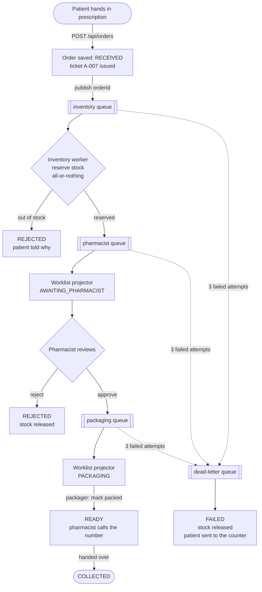
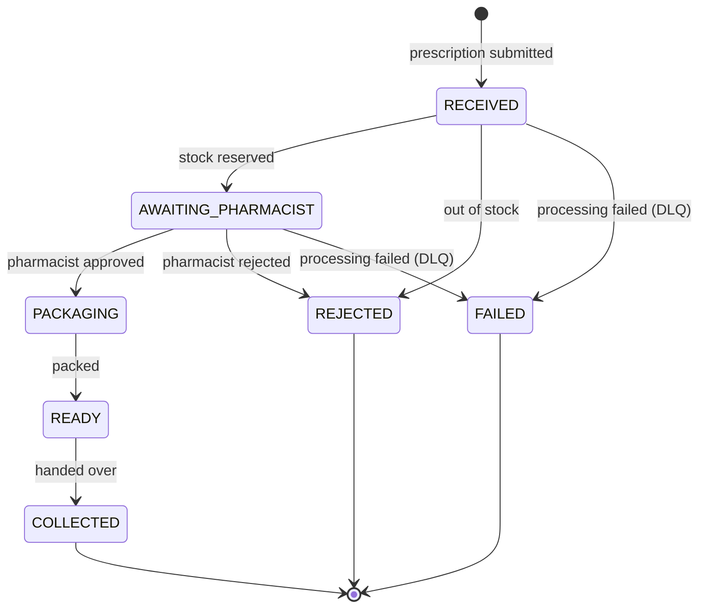
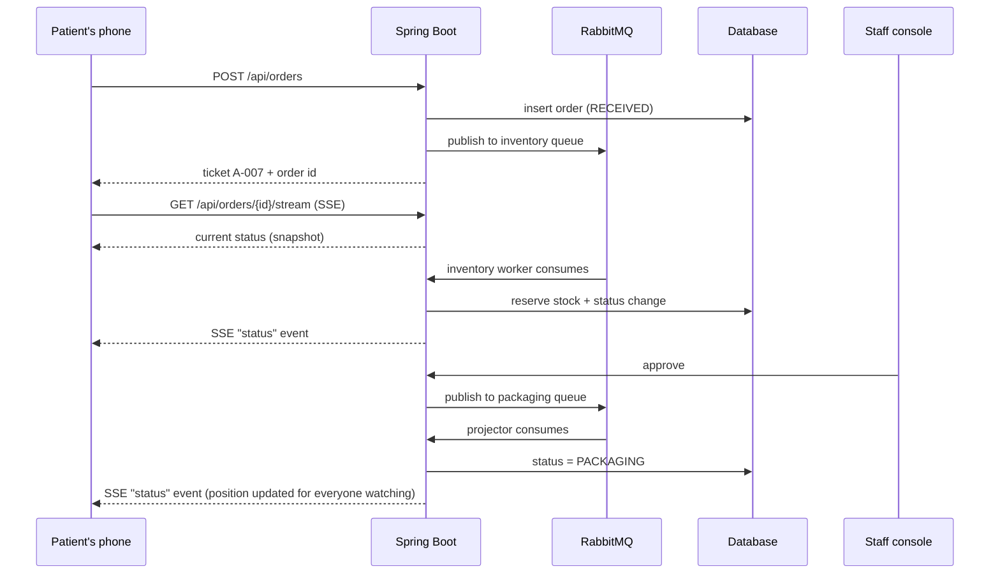

# Pharmacy Ordering System

Prescription-to-patient fulfillment for a pharmacy, built with **Kotlin + Spring Boot + RabbitMQ**.

A patient hands in a prescription, gets a **ticket number** (e.g. `A-007`), and watches a live status page on their phone until the pharmacist calls that number. Pharmacists and packagers get a deliberately basic console.

---

## Run it

Prerequisites: Docker, JDK 21.

**Everything in Docker**

```bash
docker compose up --build
```

**Or: RabbitMQ in Docker, app on your machine**

```bash
docker compose up -d rabbitmq
./gradlew bootRun
```

Then open:

| URL | Who | What |
|---|---|---|
| http://localhost:8080/ | Patient / reception | Drop off a prescription, get a ticket, track it |
| http://localhost:8080/track.html?id=... | Patient | Live status (opened automatically after submitting) |
| http://localhost:8080/board.html | Waiting room screen | "Now ready" ticket numbers |
| http://localhost:8080/staff.html | Pharmacist + packager | Approve, reject, pack, hand over |
| http://localhost:15672 (guest/guest) | Ops | RabbitMQ management UI (queues, DLQ) |

**Demo script (2 minutes)**

1. Open `/` in one tab, `/staff.html` in another, `/board.html` on a third.
2. Submit a prescription (e.g. Amoxicillin x1). You land on the tracker showing your ticket.
3. In the staff tab: **Approve** → the tracker moves to "being prepared". **Mark packed** → the tracker turns green, the phone vibrates, the board shows your number. **Handed over** completes it.
4. Out-of-stock path: order 3 x *Salbutamol* (only 2 in stock) → the patient is told immediately, nothing is reserved.
5. Failure path: stop RabbitMQ (`docker compose stop rabbitmq`), submit an order → you still get a ticket; start RabbitMQ again → the order continues by itself.

Tests: `./gradlew test`

---

## The order flow



### What the patient sees at each step



| Status | Patient screen | Detail line |
|---|---|---|
| `RECEIVED` | We've received your prescription | Checking that everything is in stock |
| `AWAITING_PHARMACIST` | The pharmacist is reviewing your prescription | "You're next" / "N prescriptions ahead of yours" |
| `PACKAGING` | Your medication is being prepared | Position in the packaging queue |
| `READY` | Your prescription is ready! (green, vibrates) | Go to the counter, your number is A-007 |
| `COLLECTED` | All done, thank you | — |
| `REJECTED` | We couldn't fill this prescription | Reason + "please speak to the pharmacist" |
| `FAILED` | Something went wrong on our side | "Please go to the counter with your ticket" |

### Live updates to the waiting room



---

## Design decisions

| Decision | Why |
|---|---|
| **Server-Sent Events** for patient tracking | One-way, auto-reconnecting (`EventSource`), plain HTTP, no extra infrastructure. Patients only need to *receive*. On every (re)connect the server sends the current status first, so a dropped connection never leaves a stale screen. |
| **Polling fallback** on the tracker | If SSE is blocked (some proxies/captive Wi-Fi), the page polls every 10s while disconnected, and shows "Reconnecting…". |
| **Ticket number** instead of names | Patients wait in a public room. The board and tracker show only the ticket. The tracking API returns **no patient name and no medications**. |
| **Queue message = order id only** | The database is the source of truth. A redelivered or delayed message can never apply stale data. |
| **State changes only happen in queue consumers** (after `RECEIVED`) | One uniform path. Human actions (approve, reject) validate the current state and publish; consumers apply the transition. |
| **State machine in one place** (`OrderStatus`) | Legal transitions live in the enum; every update is a guarded SQL `UPDATE ... WHERE status IN (...)`, so concurrent or duplicate actions cannot corrupt state. |
| **Stock reserved atomically** | `UPDATE stock SET quantity = quantity - ? WHERE quantity >= ?` inside one transaction per prescription (all items or none). |
| **Live queue positions** | Whenever any order changes, every connected tracker is recomputed and pushed only if its view changed. |
| **H2 file database** | Zero setup. Data survives restarts. `JdbcTemplate` keeps SQL visible. Swap for Postgres by changing the datasource. |
| **Staff UI is intentionally plain** | Per the brief, effort went into the patient experience. |

## Failure handling

| What fails | What happens | Where the patient sees it |
|---|---|---|
| RabbitMQ is down when the patient submits | Order is saved and a ticket issued anyway. `StuckOrderSweeper` (every 15s) republishes orders stuck in `RECEIVED`. | Nothing: they wait slightly longer |
| A consumer throws (e.g. transient DB error) | 3 attempts with exponential backoff (500ms, 1s) | Nothing |
| All attempts fail | Message is dead-lettered. `DeadLetterWorker` marks the order `FAILED`, releases reserved stock. | "Something went wrong on our side, please go to the counter" + shown in the staff "Needs attention" list |
| Duplicate message delivery | Consumers are idempotent (status guard + "already reserved" flag) | Nothing |
| Item out of stock | Whole prescription rolled back, nothing reserved | Immediate explanation |
| Pharmacist rejects | Reserved stock is released | Reason shown to the patient |
| Approve clicked while broker is down | HTTP 503, state unchanged, the pharmacist just clicks again | Nothing |
| Patient's connection drops | `EventSource` reconnects; server re-sends the current status; polling fallback meanwhile | "Reconnecting…" indicator |
| Two staff act on the same order | Guarded update: one wins, the other gets HTTP 409 | Nothing |

Known limitation: if the dead-letter handler itself keeps failing, that message is dropped after its retries. Next step would be a parking-lot queue plus an alert.

## Assumptions

- Reception enters the prescription (patient name + medications and quantities) at intake; no doctor integration.
- One prescription can contain several medications; it is fulfilled as a unit.
- Staff endpoints are unauthenticated. In production they would sit behind SSO/roles.
- Queue position is first-come-first-served by ticket number; no priority handling.
- No wait-time estimate is shown, because inventing one would mislead patients. Queue position is shown instead.

## API

| Method | Path | Purpose |
|---|---|---|
| `GET` | `/api/medications` | Catalogue with availability |
| `POST` | `/api/orders` | Submit prescription → `{orderId, ticket}` |
| `GET` | `/api/orders/{id}` | Current status snapshot |
| `GET` | `/api/orders/{id}/stream` | SSE stream of status changes |
| `GET` | `/api/tickets/{number}` | Find an order id by ticket number |
| `GET` | `/api/board` | Ready / preparing ticket numbers |
| `GET` | `/api/staff/overview` | All work lists + stock |
| `POST` | `/api/staff/orders/{id}/approve` | Pharmacist approves |
| `POST` | `/api/staff/orders/{id}/reject?reason=` | Pharmacist rejects |
| `POST` | `/api/staff/orders/{id}/packed` | Packager marks packed → READY |
| `POST` | `/api/staff/orders/{id}/collected` | Handed over to the patient |

## RabbitMQ topology

- Exchange `pharmacy.orders` (direct) with queues `pharmacy.inventory`, `pharmacy.pharmacist`, `pharmacy.packaging`.
- Each work queue dead-letters to exchange `pharmacy.dlx` with its own routing key (`dead.inventory`, `dead.pharmacist`, `dead.packaging`), all bound to `pharmacy.dead-letter`. The key tells the handler which stage failed, so a stale duplicate can never fail an order that has already moved on.

## Project layout

```
src/main/kotlin/com/pharmacy
  domain/            OrderStatus (state machine), order model, errors
  application/       OrderService (use cases), InventoryService, views
  infrastructure/
    persistence/     JdbcTemplate repositories, stock seeding
    messaging/       Topology, RabbitMQ config, publisher, workers, sweeper
    sse/             StatusHub (SSE connections + heartbeat)
  web/               REST controllers, error handling
src/main/resources
  schema.sql, application.properties
  static/            index, track, board, staff pages
```

## What I would do next

- Integration test with Testcontainers (real RabbitMQ) covering the DLQ path end to end.
- Publisher confirms and an outbox table instead of the sweeper.
- Authentication and audit trail for staff actions.
- Web push / SMS when the order is ready, for patients who leave the waiting room.
- Metrics (queue depth, time per stage) and an alert on the dead-letter queue.
- Postgres instead of H2.
